# 1. Mục tiêu tuần 2

Sau khi hoàn thành việc chuẩn bị môi trường AWS, thiết kế kiến trúc và khởi tạo cơ sở dữ liệu trong tuần 1, nhóm tiếp tục xây dựng các thành phần xử lý và kết nối của hệ thống quản lý sinh viên. Mục tiêu trong tuần này gồm:

- Xây dựng các hàm AWS Lambda xử lý nghiệp vụ thêm, đọc, cập nhật và xóa hồ sơ sinh viên (CRUD).
- Kết nối Lambda với bảng `Students` trên DynamoDB bằng quyền truy cập được cấp trong AWS Learner Lab.
- Tạo REST API bằng Amazon API Gateway để tiếp nhận yêu cầu từ giao diện.
- Kiểm thử các chức năng API và luồng hoạt động từ giao diện web đến cơ sở dữ liệu.

# 2. Nội dung công việc

## 2.1. Cấu hình quyền truy cập cho AWS Lambda

Các hàm Lambda cần quyền truy cập DynamoDB để thao tác với dữ liệu sinh viên, đồng thời cần ghi nhật ký thực thi lên CloudWatch. Nhóm sử dụng IAM Role `LabRole` được cấp sẵn trong AWS Learner Lab và gắn role này cho các hàm Lambda, không tạo IAM Role mới.

  <figure>
    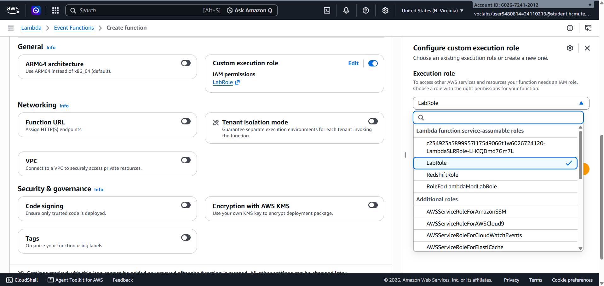
    <figcaption style="font-style: italic; color: gray;">
      Hình 1. Cấu hình IAM LabRole cho AWS Lambda
    </figcaption>
  </figure>

## 2.2. Xây dựng các hàm AWS Lambda

Nhóm triển khai các hàm Lambda bằng Python để xử lý những thao tác CRUD trên bảng `Students`. Mỗi hàm nhận thông tin từ sự kiện HTTP, thực hiện thao tác tương ứng trên DynamoDB và trả về mã trạng thái cùng dữ liệu phản hồi.

### 2.2.1. Hàm CreateStudent

Hàm `CreateStudent` tiếp nhận dữ liệu sinh viên dạng JSON, ghi hồ sơ vào DynamoDB và bổ sung thời điểm tạo, cập nhật (`created_at`, `updated_at`). Nhóm kiểm thử hàm với dữ liệu mẫu và xác nhận thao tác tạo thành công trả về mã HTTP `201`.

  <figure>
    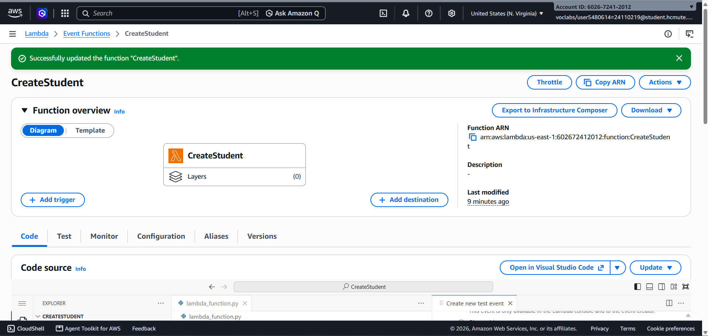
    <figcaption style="font-style: italic; color: gray;">
      Hình 2. Khởi tạo hàm Lambda CreateStudent
    </figcaption>
  </figure>

  <figure>
    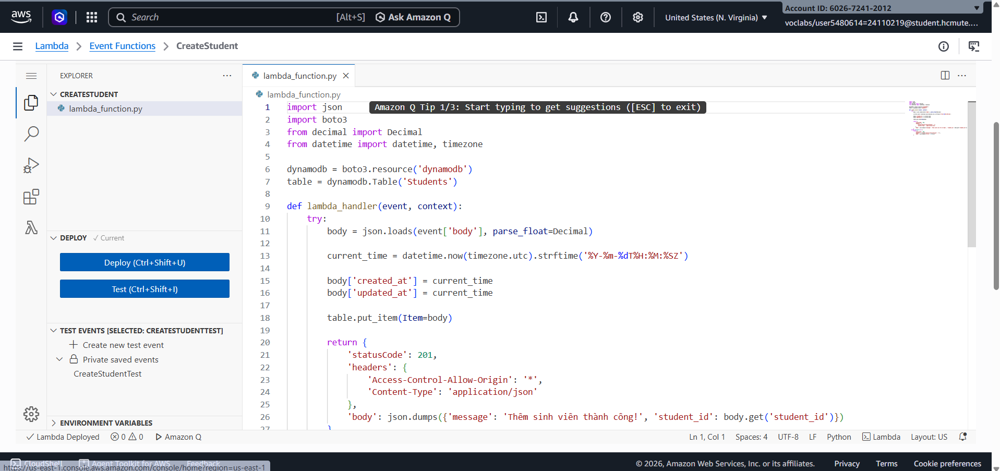
    <figcaption style="font-style: italic; color: gray;">
      Hình 3. Mã nguồn xử lý tạo hồ sơ sinh viên
    </figcaption>
  </figure>

  <figure>
    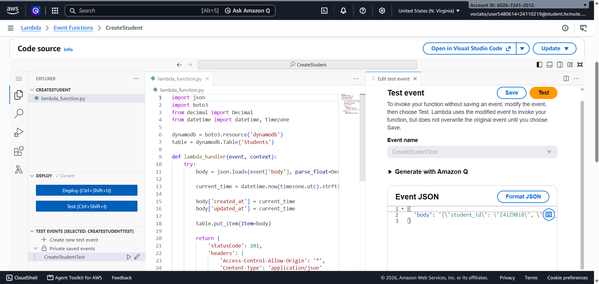
    <figcaption style="font-style: italic; color: gray;">
      Hình 4. Dữ liệu JSON dùng để kiểm thử CreateStudent
    </figcaption>
  </figure>

  <figure>
    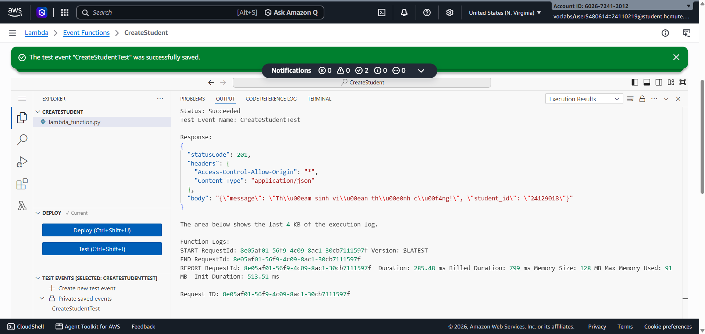
    <figcaption style="font-style: italic; color: gray;">
      Hình 5. Kết quả tạo sinh viên thành công với mã HTTP 201
    </figcaption>
  </figure>

### 2.2.2. Hàm UpdateStudent

Hàm `UpdateStudent` cập nhật các thuộc tính được gửi lên thay vì ghi đè toàn bộ hồ sơ. Nhóm kiểm thử cả trường hợp mã sinh viên không tồn tại và trường hợp cập nhật hợp lệ: yêu cầu không tìm thấy dữ liệu trả về `404`, còn cập nhật thành công trả về `200`.

  <figure>
    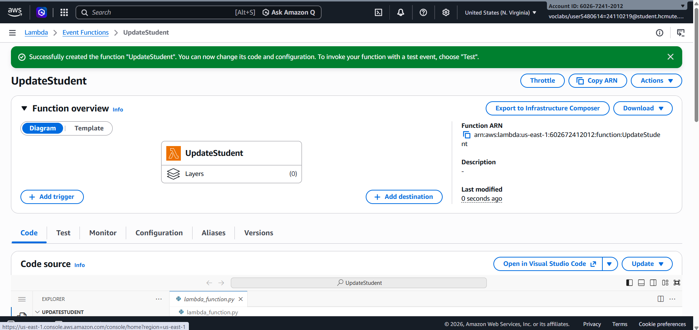
    <figcaption style="font-style: italic; color: gray;">
      Hình 6. Khởi tạo hàm Lambda UpdateStudent
    </figcaption>
  </figure>

  <figure>
    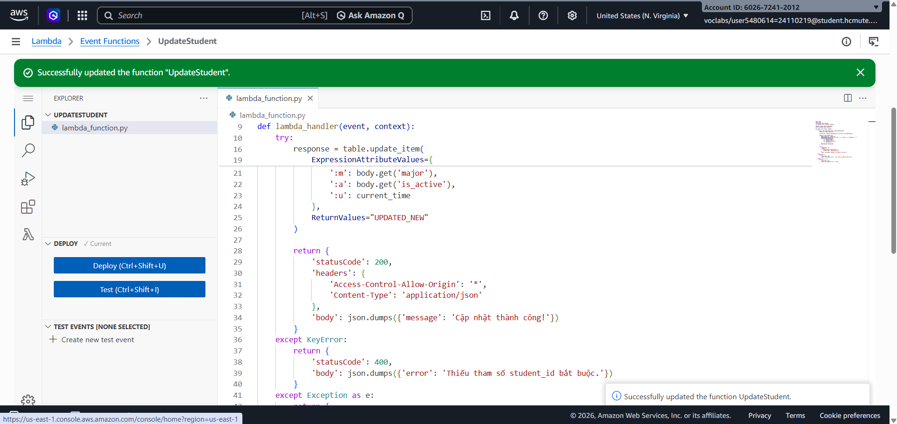
    <figcaption style="font-style: italic; color: gray;">
      Hình 7. Mã nguồn cập nhật hồ sơ sinh viên
    </figcaption>
  </figure>

  <figure>
    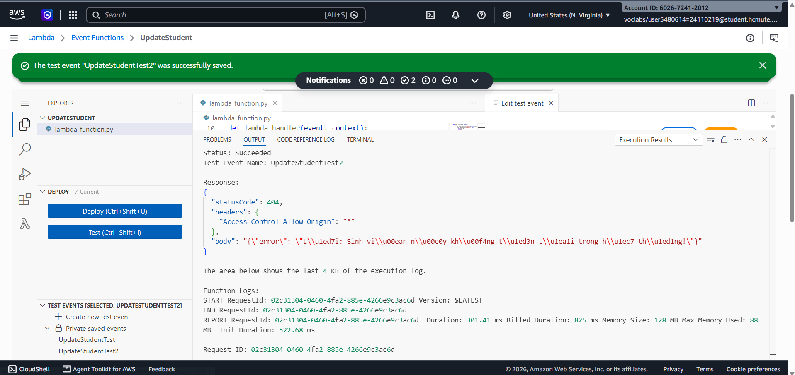
    <figcaption style="font-style: italic; color: gray;">
      Hình 8. Kiểm thử cập nhật mã sinh viên không tồn tại
    </figcaption>
  </figure>

  <figure>
    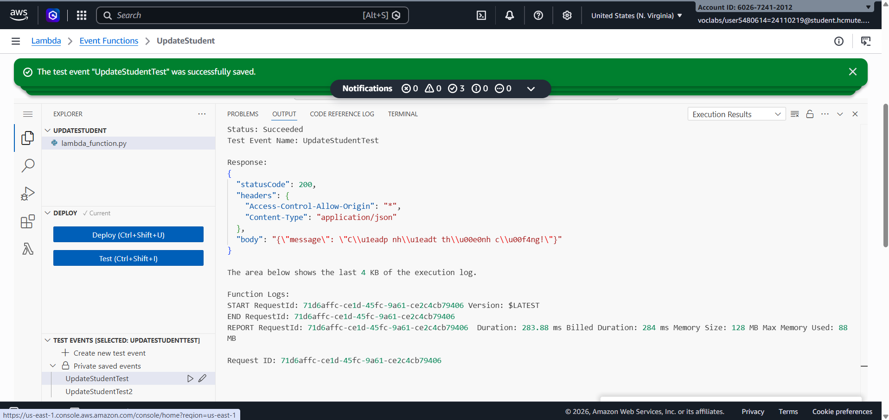
    <figcaption style="font-style: italic; color: gray;">
      Hình 9. Kiểm thử cập nhật sinh viên thành công với mã HTTP 200
    </figcaption>
  </figure>

### 2.2.3. Hàm GetStudents

Hàm `GetStudents` hỗ trợ ba trường hợp truy vấn: lấy toàn bộ danh sách khi không có tham số truy vấn, tìm theo `student_id` và lọc theo `major` thông qua GSI `major-index` đã tạo trong tuần 1. Nhóm kiểm thử hàm bằng các sự kiện có `queryStringParameters` như sau:

- **Hình 12 – Lấy toàn bộ danh sách:** `queryStringParameters` là `null`.
- **Hình 13 – Tìm theo mã sinh viên:** `queryStringParameters` có `student_id` với giá trị `24129018`.
- **Hình 14 – Lọc theo chuyên ngành:** `queryStringParameters` có `major` với giá trị `Information Technology`.

Các kết quả kiểm thử xác nhận hàm xử lý đúng từng kiểu truy vấn và trả về dữ liệu tương ứng.

  <figure>
    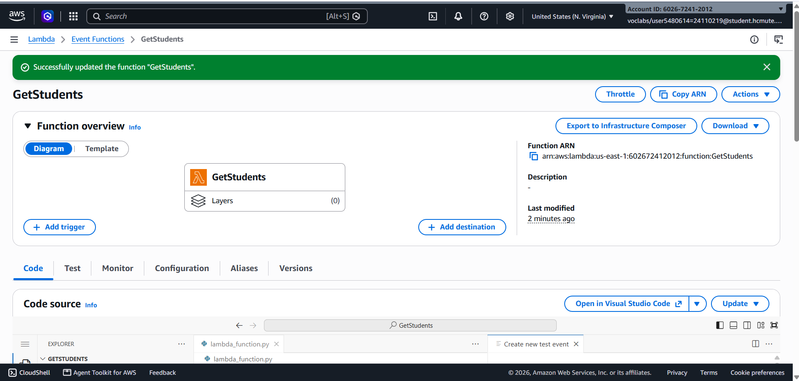
    <figcaption style="font-style: italic; color: gray;">
      Hình 10. Khởi tạo hàm Lambda GetStudents
    </figcaption>
  </figure>

  <figure>
    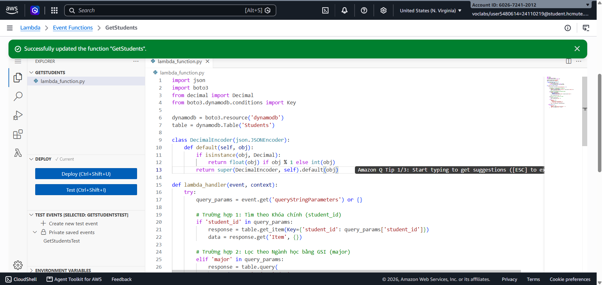
    <figcaption style="font-style: italic; color: gray;">
      Hình 11. Mã nguồn truy vấn danh sách sinh viên
    </figcaption>
  </figure>

  <figure>
    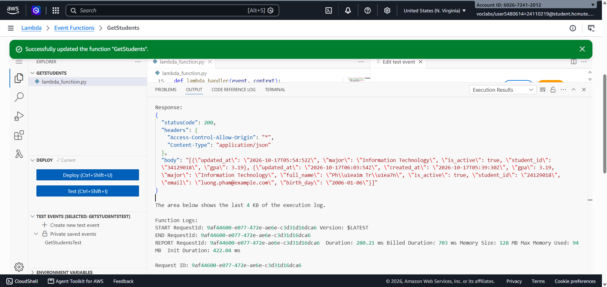
    <figcaption style="font-style: italic; color: gray;">
      Hình 12. Kết quả lấy toàn bộ danh sách khi queryStringParameters là null
    </figcaption>
  </figure>

  <figure>
    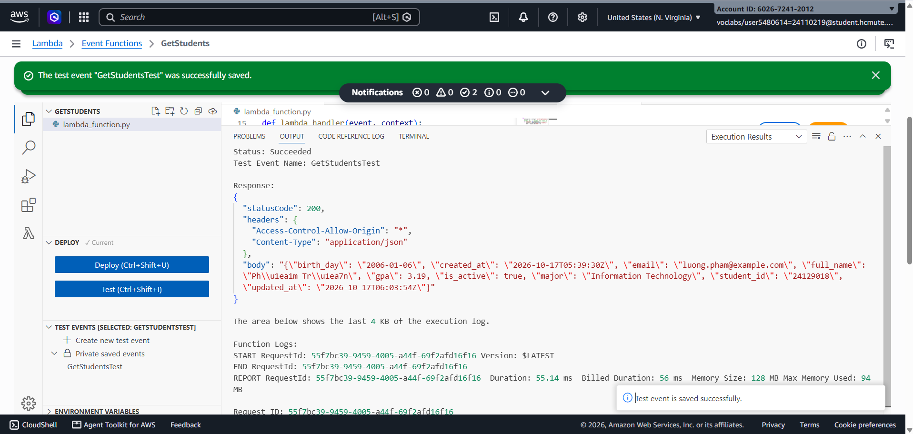
    <figcaption style="font-style: italic; color: gray;">
      Hình 13. Kết quả truy vấn theo student_id = 24129018
    </figcaption>
  </figure>

  <figure>
    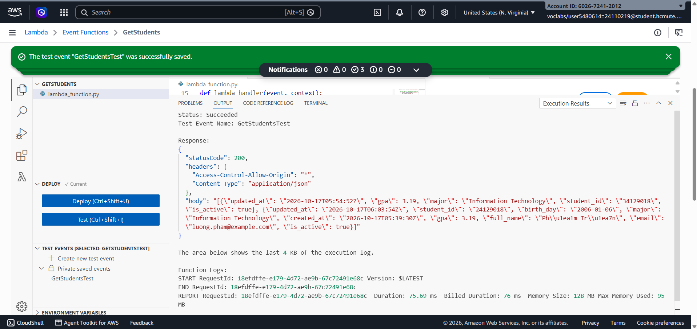
    <figcaption style="font-style: italic; color: gray;">
      Hình 14. Kết quả truy vấn theo major = Information Technology qua GSI
    </figcaption>
  </figure>

### 2.2.4. Hàm DeleteStudent

Hàm `DeleteStudent` xóa hồ sơ theo `student_id`. Nhóm kiểm thử cả trường hợp mã sinh viên không tồn tại và trường hợp xóa thành công để đảm bảo phản hồi của hàm phù hợp với kết quả thao tác.

  <figure>
    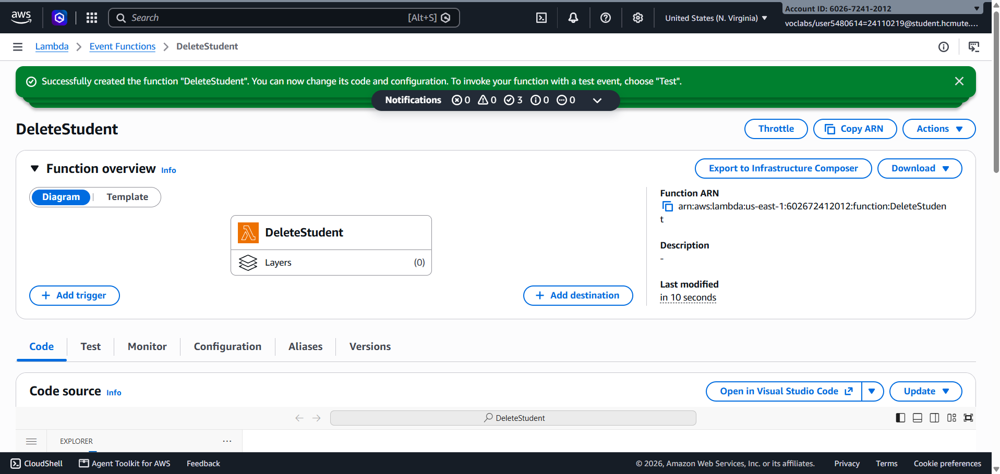
    <figcaption style="font-style: italic; color: gray;">
      Hình 15. Khởi tạo hàm Lambda DeleteStudent
    </figcaption>
  </figure>

  <figure>
    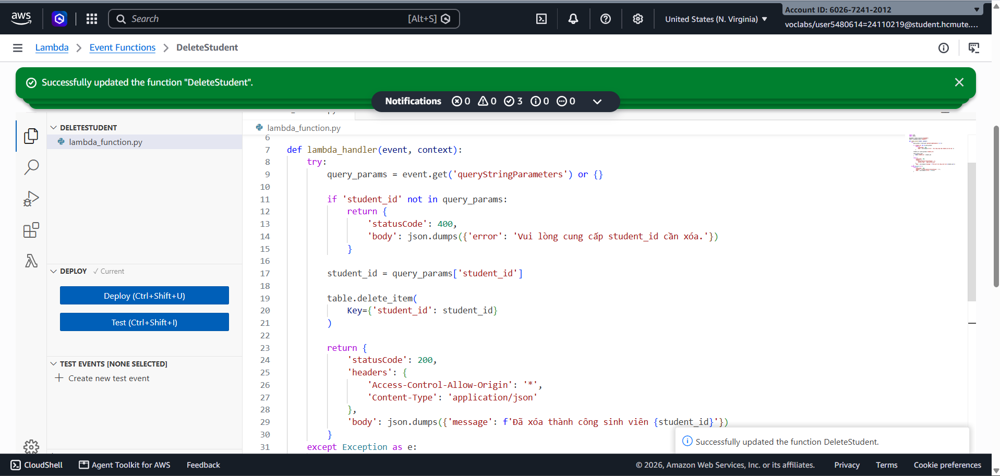
    <figcaption style="font-style: italic; color: gray;">
      Hình 16. Mã nguồn xóa hồ sơ sinh viên
    </figcaption>
  </figure>

  <figure>
    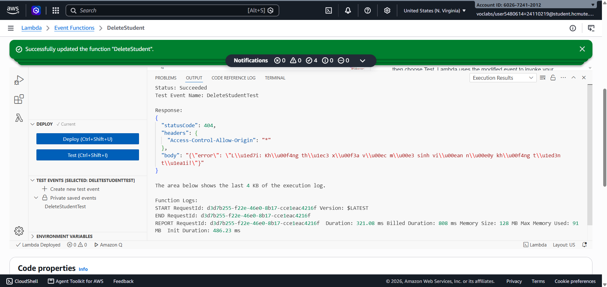
    <figcaption style="font-style: italic; color: gray;">
      Hình 17. Kiểm thử xóa mã sinh viên không tồn tại
    </figcaption>
  </figure>

  <figure>
    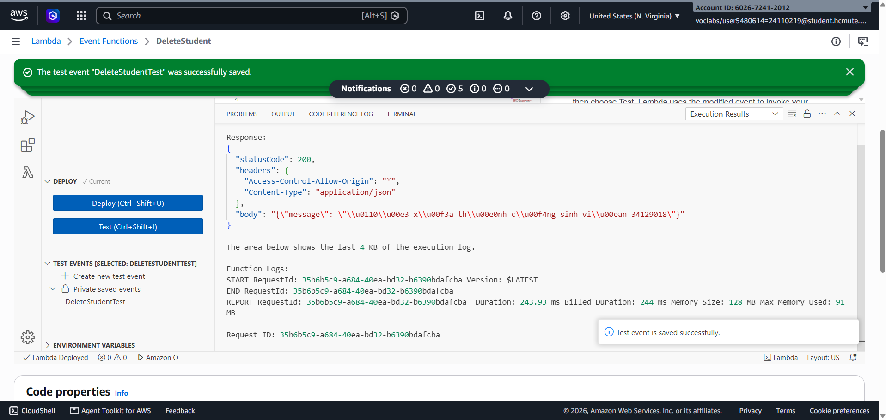
    <figcaption style="font-style: italic; color: gray;">
      Hình 18. Kiểm thử xóa sinh viên thành công với mã HTTP 200
    </figcaption>
  </figure>

## 2.3. Thiết lập Amazon API Gateway

Sau khi xây dựng các hàm xử lý, nhóm tạo REST API trên Amazon API Gateway để làm đầu mối tiếp nhận yêu cầu từ giao diện. API sử dụng resource `/students` và Lambda Proxy Integration để chuyển tiếp yêu cầu đến các hàm Lambda tương ứng.

Các phương thức HTTP `GET`, `POST`, `PUT` và `DELETE` được cấu hình phục vụ thao tác đọc, tạo, cập nhật và xóa dữ liệu. Nhóm bật CORS để cho phép giao diện web gọi API khác nguồn, sau đó triển khai API lên stage `dev`.

  <figure>
    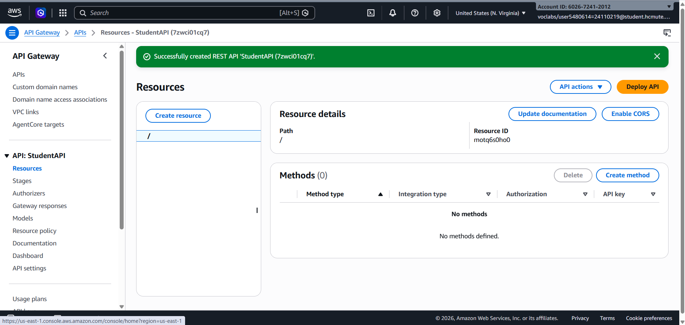
    <figcaption style="font-style: italic; color: gray;">
      Hình 19. Khởi tạo REST API trên Amazon API Gateway
    </figcaption>
  </figure>

  <figure>
    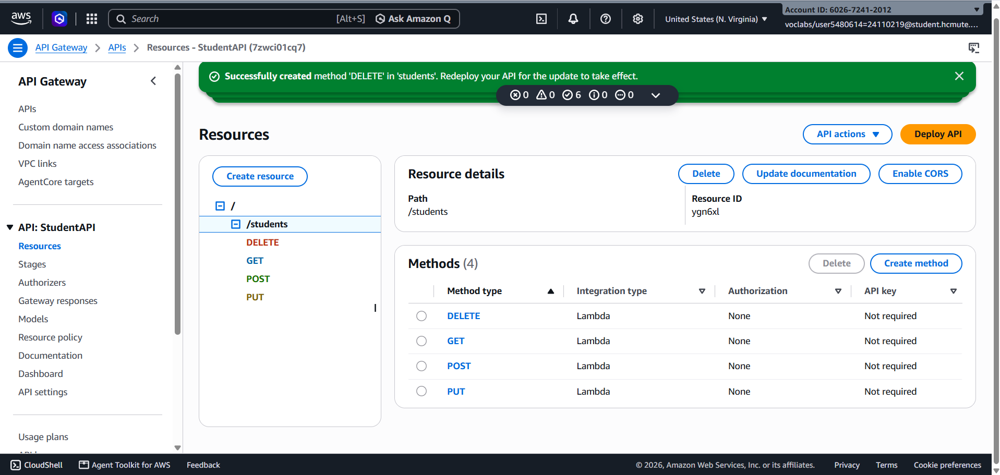
    <figcaption style="font-style: italic; color: gray;">
      Hình 20. Cấu hình các phương thức API phục vụ CRUD
    </figcaption>
  </figure>

  <figure>
    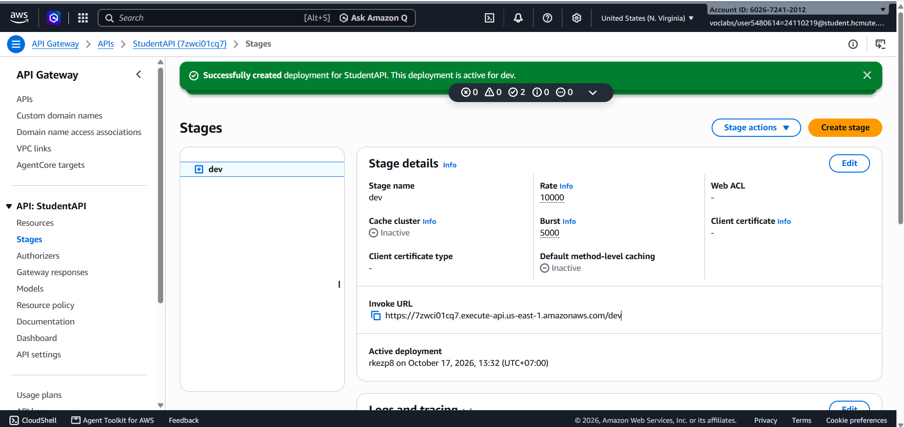
    <figcaption style="font-style: italic; color: gray;">
      Hình 21. Triển khai API lên stage dev
    </figcaption>
  </figure>

## 2.4. Kiểm thử tích hợp với giao diện

Nhóm sử dụng giao diện web tĩnh để gọi API bằng Fetch API và kiểm tra luồng dữ liệu từ giao diện qua API Gateway, Lambda đến DynamoDB. Các thao tác đọc, cập nhật, tạo mới và xóa được kiểm thử trực tiếp; kết quả hiển thị trên giao diện tương ứng với phản hồi từ API.

  <figure>
    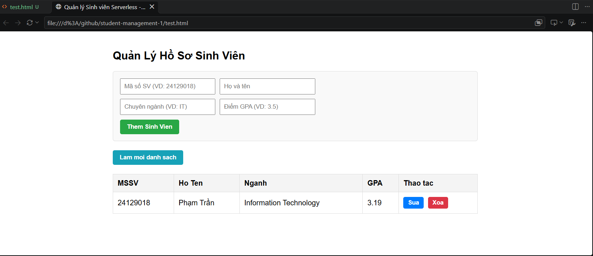
    <figcaption style="font-style: italic; color: gray;">
      Hình 22. Kiểm thử lấy danh sách sinh viên trên giao diện
    </figcaption>
  </figure>

  <figure>
    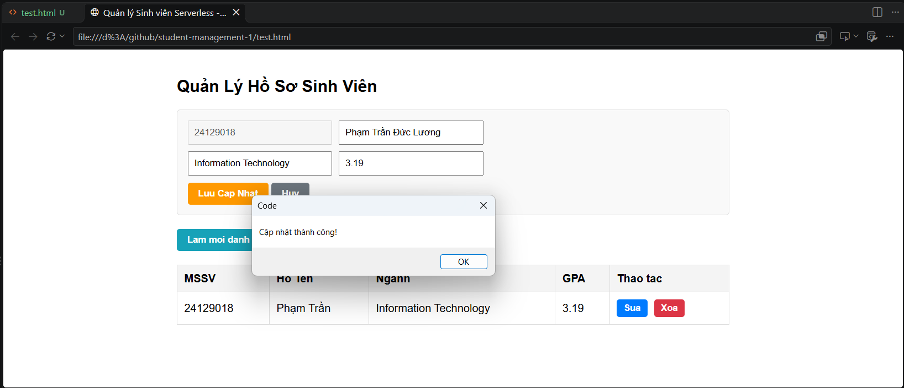
    <figcaption style="font-style: italic; color: gray;">
      Hình 23. Kiểm thử cập nhật sinh viên trên giao diện
    </figcaption>
  </figure>

  <figure>
    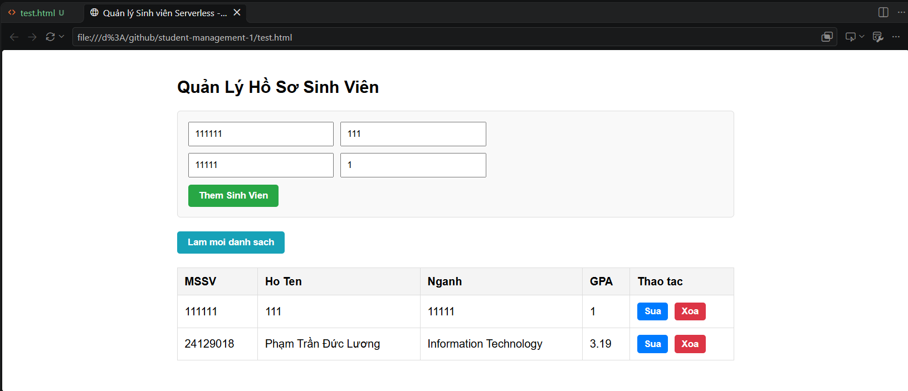
    <figcaption style="font-style: italic; color: gray;">
      Hình 24. Kiểm thử tạo sinh viên trên giao diện
    </figcaption>
  </figure>

  <figure>
    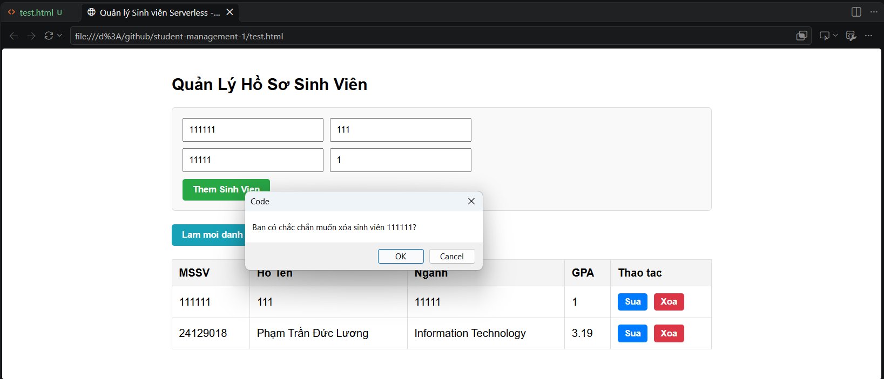
    <figcaption style="font-style: italic; color: gray;">
      Hình 25. Giao diện xác nhận thao tác xóa sinh viên
    </figcaption>
  </figure>

  <figure>
    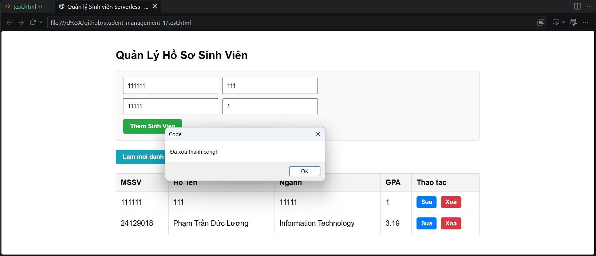
    <figcaption style="font-style: italic; color: gray;">
      Hình 26. Kiểm thử xóa sinh viên thành công trên giao diện
    </figcaption>
  </figure>

# 3. Khó khăn và giải pháp

Trong quá trình xử lý cập nhật và xóa, DynamoDB có thể tạo bản ghi mới khi cập nhật một khóa chưa tồn tại hoặc không báo lỗi khi yêu cầu xóa không tìm thấy bản ghi. Hành vi này có thể khiến API phản hồi thành công dù mã sinh viên không tồn tại.

Để xử lý đúng trường hợp này, nhóm bổ sung điều kiện `attribute_exists(student_id)` cho thao tác cập nhật và xóa. Khi điều kiện không thỏa mãn, hàm bắt lỗi `ConditionalCheckFailedException` thông qua `botocore.exceptions.ClientError` và trả về mã HTTP `404`. Qua đó, API phân biệt rõ trường hợp không tìm thấy sinh viên với thao tác thành công.

# 4. Kết quả công việc tuần 2

- Xây dựng và kiểm thử các hàm Lambda `CreateStudent`, `UpdateStudent`, `GetStudents` và `DeleteStudent` kết nối với bảng `Students`.
- Hoàn thiện các thao tác truy vấn danh sách, theo mã sinh viên và theo chuyên ngành thông qua GSI `major-index`.
- Tạo REST API với các phương thức CRUD, cấu hình Lambda Proxy Integration, CORS và triển khai lên stage `dev`.
- Kiểm thử thành công các luồng tạo, đọc, cập nhật và xóa từ giao diện; xác nhận các trường hợp không tìm thấy sinh viên trả về HTTP `404`.
- Hoàn thành kết nối các thành phần S3, API Gateway, Lambda và DynamoDB cho luồng hoạt động chính của hệ thống.
