# 1. Mục tiêu tuần 3

Mục tiêu của tuần 3 tập trung vào việc hoàn thiện hệ thống, triển khai giao diện người dùng (Frontend), thiết lập các lớp bảo mật cho API và áp dụng cơ chế giám sát. Cụ thể như sau:

- Nâng cao bảo mật cho API Gateway bằng cách bắt buộc sử dụng API Key cho các thao tác CRUD.
- Tạo và liên kết Usage Plan với API Key nhằm kiểm soát lưu lượng, bảo vệ tài nguyên hệ thống và thống kê sử dụng.
- Cập nhật mã nguồn Frontend `index.html`: cập nhật giao diện hiển thị dữ liệu và API Key để tích hợp API Key vào Header của các Fetch request.
- Triển khai ứng dụng Web lên Amazon S3 dưới dạng Static Website và thực hiện kiểm thử End-to-End trực tiếp trên môi trường Cloud.
- Cấu hình IAM Role và kích hoạt tính năng ghi log (Access Logging), thu thập Metrics chi tiết cho API Gateway trên Amazon CloudWatch.
- Giám sát, phân tích các chỉ số và trích xuất dữ liệu báo cáo từ CloudWatch.

---

# 2. Nội dung công việc

## 2.1. Cấu hình Bảo mật và Quản lý lưu lượng với API Gateway

*   **API Key:** Là một chuỗi ký tự định danh duy nhất được truyền qua HTTP Header. Nó hoạt động như một lớp bảo mật cơ bản để xác định ai đang gọi API, từ đó ngăn chặn các truy cập nặc danh trái phép.
*   **Usage Plan:** Là cơ chế để bảo vệ Backend khỏi sự cố quá tải, bao gồm:
    *   **Throttling:** Kiểm soát số lượng request trong một giây (Rate) và số request tối đa có thể xử lý đồng thời (Burst).
    *   **Quota:** Tổng số request tối đa client được phép gọi trong một khoảng thời gian.

Để ngăn chặn truy cập trái phép và bảo vệ hệ thống khỏi các cuộc tấn công DDoS hoặc spam request, nhóm đã thiết lập thêm 2 lớp bảo mật trên API Gateway:

- **API Keys**: Đóng vai trò như một mật khẩu tĩnh. Bất kỳ ứng dụng nào muốn gọi API đều phải đính kèm chuỗi Key này trong Header của HTTP Request. Nhóm đã khởi tạo một API Key mang tên `StudentWebKey`.

  <figure>
    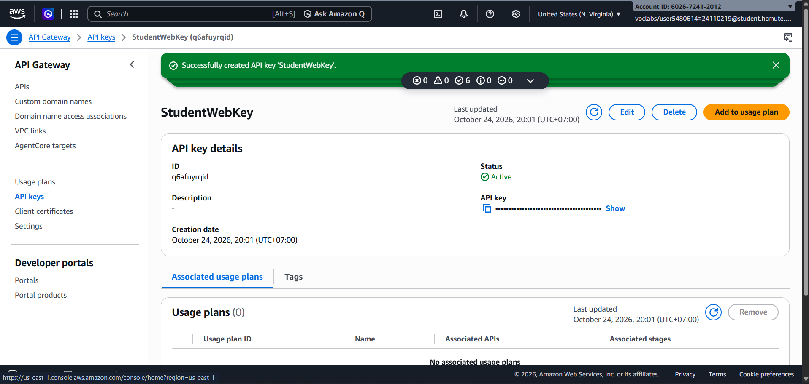
    <figcaption style="font-style: italic; color: gray;">
      Hình 1. Khởi tạo API Key trên AWS API Gateway.
    </figcaption>
  </figure>

- **Usage Plans**: Nhóm tạo một gói `BasicPlan` với các thông số:
    - **Rate**: 5 requests/second.
    - **Burst**: 10 requests.
    - **Quota**: 1000 requests/month.

  <figure>
    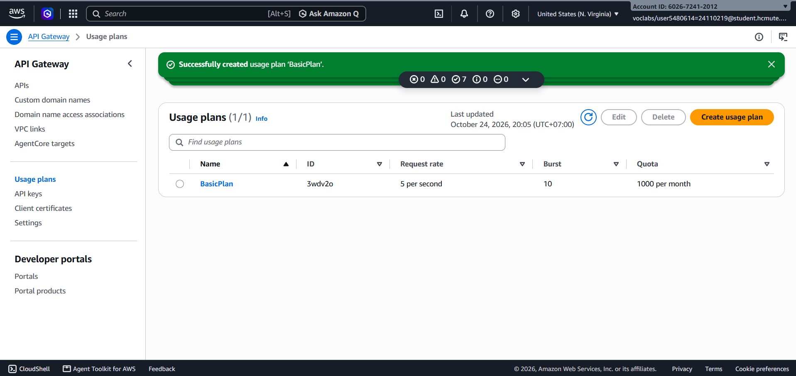
    <figcaption style="font-style: italic; color: gray;">
      Hình 2. Tạo Usage Plan với các thiết lập giới hạn lưu lượng.
    </figcaption>
  </figure>

Sau khi tạo thành công, nhóm tiến hành liên kết Usage Plan này với môi trường triển khai (`dev` stage) của `StudentAPI` và gán API Key `StudentWebKey`.

  <figure>
    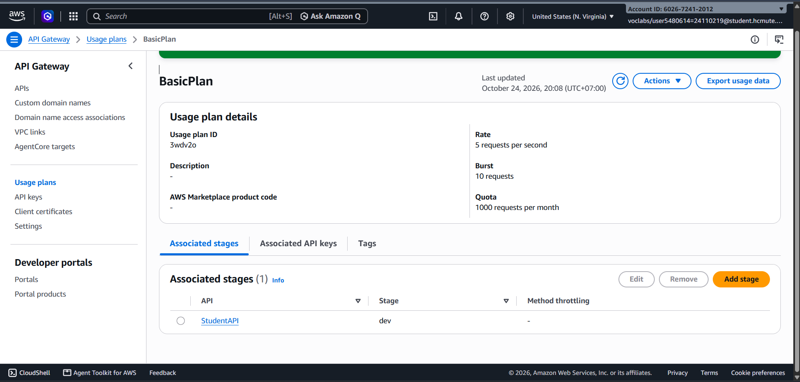
    <figcaption style="font-style: italic; color: gray;">
      Hình 3. Liên kết Usage Plan với môi trường triển khai của StudentAPI.
    </figcaption>
  </figure>

  <figure>
    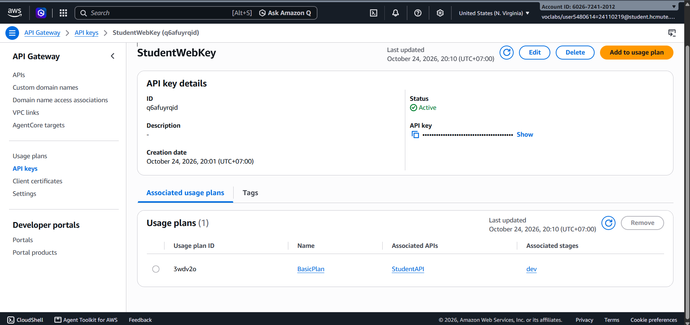
    <figcaption style="font-style: italic; color: gray;">
      Hình 4. Gán API Key vào Usage Plan để bắt đầu quản lý.
    </figcaption>
  </figure>

---

## 2.2. Triển khai Frontend lên Amazon S3 và Kiểm thử E2E

Sau khi API Gateway đã được bảo mật, mã nguồn Frontend (`index.html`) được cập nhật thêm trường cấu hình API Key. JavaScript sẽ tự động đính kèm `x-api-key` vào tiêu đề (Header) của các yêu cầu HTTP (`fetch`) để xác thực với AWS. Đồng thời, cấu trúc bảng trên UI cũng được đồng bộ hóa với lược đồ của DynamoDB.

File `index.html` được tải trực tiếp lên Amazon S3 Bucket `student-management-api-2026` đã cấu hình Static Website Hosting ở Tuần 1.

  <figure>
    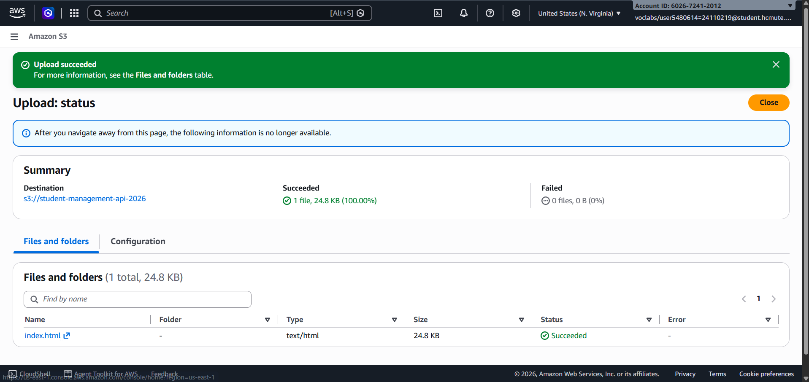
    <figcaption style="font-style: italic; color: gray;">
      Hình 5. Tải tệp index.html lên Amazon S3 Bucket.
    </figcaption>
  </figure>

Sau khi truy cập toàn cầu thông qua URL (Endpoint) do Amazon S3 cung cấp, nhóm tiến hành thực hiện chuỗi kiểm thử E2E (Thêm, Sửa, Xóa) trực tiếp từ giao diện này.

  <figure>
    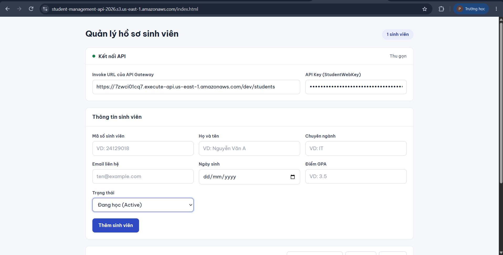
    <figcaption style="font-style: italic; color: gray;">
      Hình 6. Truy cập ứng dụng Web thành công thông qua Endpoint DNS của S3 (đã điền API URL và API Key).
    </figcaption>
  </figure>

Dữ liệu kiểm thử được nhập từ Form, thông qua Fetch API -> API Gateway (Xác thực Key) -> Lambda -> DynamoDB, và bảng danh sách ngay lập tức được làm mới, chứng minh sự liên kết thông suốt của toàn bộ hệ thống.

  <figure>
    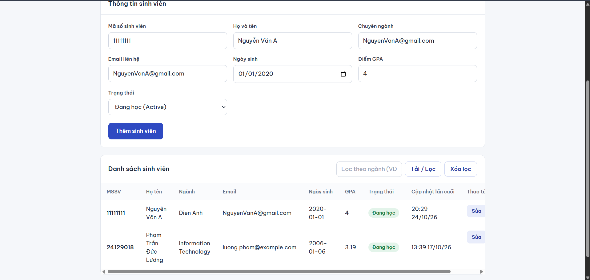
    <figcaption style="font-style: italic; color: gray;">
      Hình 7. Kiểm thử luồng E2E: Thêm mới sinh viên thành công qua giao diện Web.
    </figcaption>
  </figure>

  <figure>
    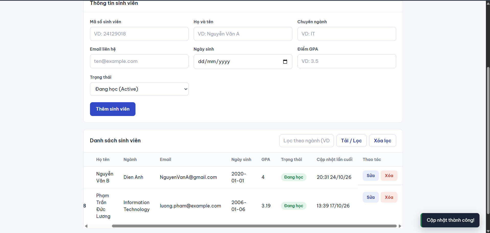
    <figcaption style="font-style: italic; color: gray;">
      Hình 8. Kiểm thử luồng E2E: Cập nhật thông tin sinh viên thành công.
    </figcaption>
  </figure>

  <figure>
    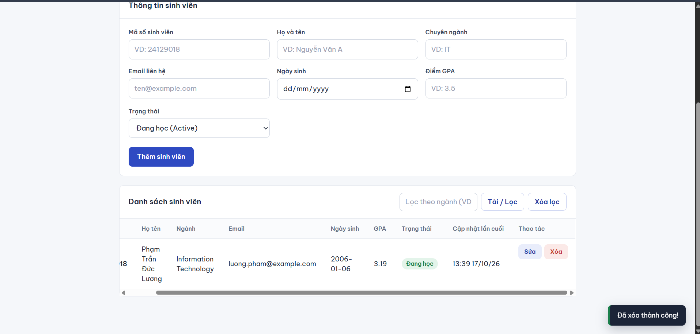
    <figcaption style="font-style: italic; color: gray;">
      Hình 9. Kiểm thử luồng E2E: Xóa sinh viên thành công.
    </figcaption>
  </figure>

---

## 2.3. Cấu hình giám sát với Amazon CloudWatch

Để đảm bảo hệ thống vận hành ổn định và có khả năng truy xuất lịch sử khi xảy ra sự cố, nhóm tích hợp Amazon CloudWatch vào API Gateway. 

Đầu tiên, API Gateway cần được cấp quyền (thông qua IAM Role) để ghi dữ liệu vào CloudWatch. Trong môi trường Learner Lab (sử dụng `LabRole` có sẵn).

  <figure>
    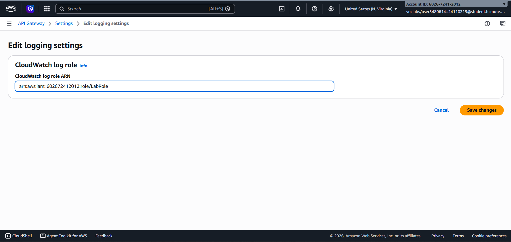
    <figcaption style="font-style: italic; color: gray;">
      Hình 10. Cấu hình IAM Role cho API Gateway để cấp quyền ghi log.
    </figcaption>
  </figure>

Tạo Log Group `/aws/apigateway/StudentAPI` trên CloudWatch.

  <figure>
    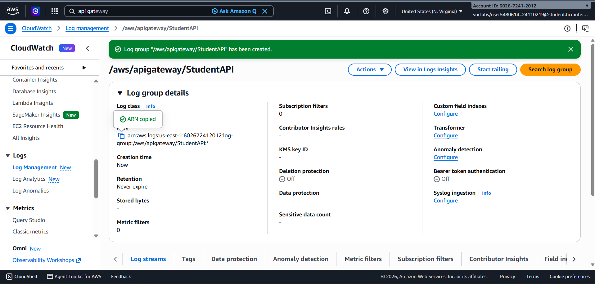
    <figcaption style="font-style: italic; color: gray;">
      Hình 11. Khởi tạo Log Group trên CloudWatch để lưu trữ log của API Gateway.
    </figcaption>
  </figure>

Trong cài đặt Stage `dev` của API Gateway, tính năng Access Logging được kích hoạt. Nhóm tùy biến định dạng ghi log dưới dạng JSON (file `infrastructure/api-gateway/access-log-format.json`) để lưu lại các thông tin thiết yếu như IP người dùng, thời gian gọi, HTTP Method, đường dẫn và mã trạng thái HTTP.

  <figure>
    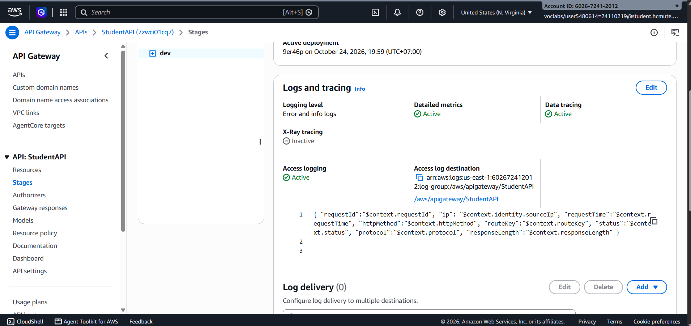
    <figcaption style="font-style: italic; color: gray;">
      Hình 12. Kích hoạt Access Logging trên API Gateway Stage và định dạng cấu trúc Log.
    </figcaption>
  </figure>

Mỗi lượt người dùng tương tác trên giao diện Web đều được ghi nhận chi tiết, hỗ trợ cho việc kiểm toán và gỡ lỗi.

  <figure>
    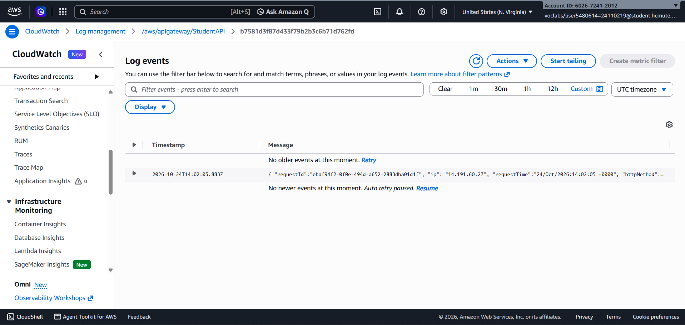
    <figcaption style="font-style: italic; color: gray;">
      Hình 13. Kiểm tra chi tiết dữ liệu của một request được ghi nhận trên CloudWatch.
    </figcaption>
  </figure>

CloudWatch Metrics giúp thu thập và trực quan hóa hiệu suất của API dưới dạng biểu đồ động.

  <figure>
    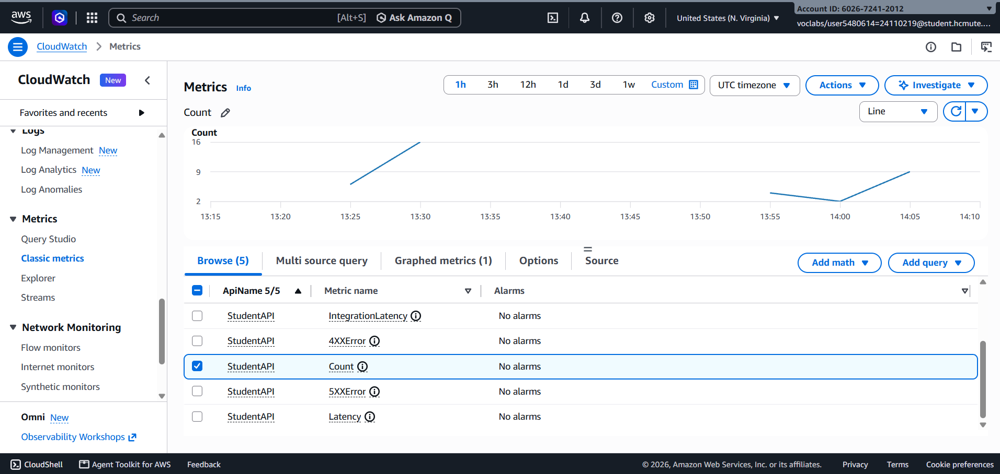
    <figcaption style="font-style: italic; color: gray;">
      Hình 14. Theo dõi biểu đồ số lượng yêu cầu (Count Metric) gọi đến API.
    </figcaption>
  </figure>

  <figure>
    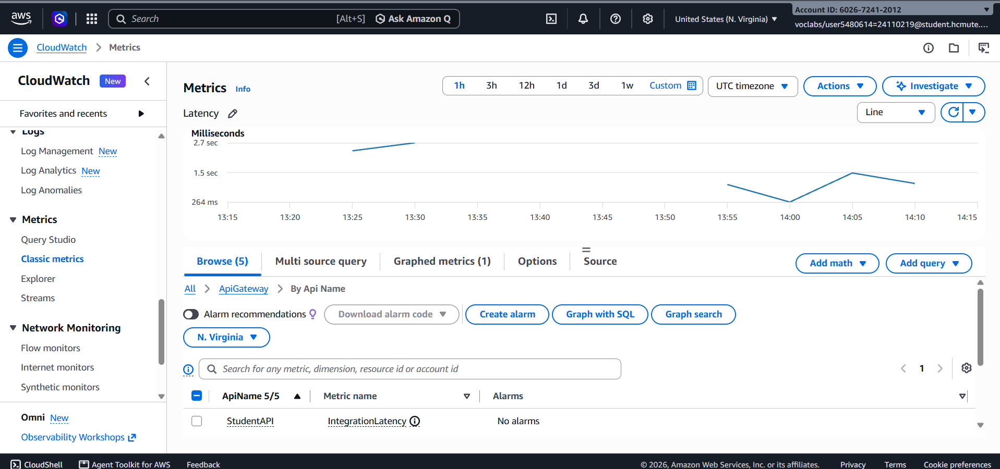
    <figcaption style="font-style: italic; color: gray;">
      Hình 15. Theo dõi biểu đồ đo lường độ trễ (Latency/Integration Latency Metric) của hệ thống.
    </figcaption>
  </figure>

API Gateway cung cấp khả năng xuất báo cáo thống kê tình trạng sử dụng Usage Plan theo định dạng JSON hoặc CSV, phục vụ mục đích theo dõi mức tiêu thụ hạn ngạch của người dùng.

  <figure>
    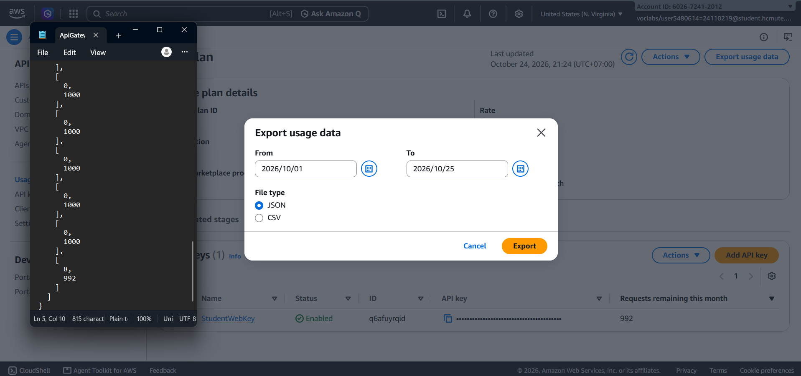
    <figcaption style="font-style: italic; color: gray;">
      Hình 16. Trích xuất dữ liệu thống kê sử dụng của API theo định dạng JSON.
    </figcaption>
  </figure>

---

# 3. Kết quả công việc tuần 3

- Hệ thống đã được tăng cường bảo mật thông qua cơ chế xác thực API Key, đồng thời ngăn chặn rủi ro quá tải bằng cấu hình Rate Limit & Quota trên Usage Plan.
- Giao diện Frontend hoàn chỉnh được lưu trữ tĩnh trên Amazon S3 và giao tiếp thành công, an toàn với backend.
- Toàn bộ luồng dữ liệu (S3 -> API Gateway -> Lambda -> DynamoDB) đã vượt qua các bài kiểm tra E2E từ phía người dùng cuối.
- Thiết lập thành công hạ tầng giám sát tập trung bằng Amazon CloudWatch (bao gồm Access Log và Metrics), đảm bảo hệ thống luôn trong trạng thái có thể quan sát.
- Dự án Serverless quản lý sinh viên đã chính thức hoàn thiện và hoạt động ổn định trên môi trường AWS Learner Lab.