# 1. Mục tiêu tuần 4

Sau khi triển khai hệ thống và cấu hình giám sát trong các tuần trước, tuần 4 tập trung cập nhật logic xử lý dữ liệu, kiểm thử tổng thể và hoàn thiện các tài liệu bàn giao. Các mục tiêu chính gồm:

- Cập nhật các hàm Lambda để kiểm tra dữ liệu đầu vào cho các thao tác CRUD và xử lý rõ các trường hợp dữ liệu không hợp lệ hoặc không tìm thấy sinh viên.
- Xuất tài liệu OpenAPI từ API Gateway và kiểm thử các endpoint bằng Postman.
- Kiểm thử lại luồng hoạt động từ giao diện website trên S3 đến API Gateway, Lambda và DynamoDB.
- Theo dõi metrics, kiểm tra mức sử dụng và chi phí AWS; lưu minh chứng và dọn dẹp tài nguyên không còn cần thiết.

# 2. Nội dung công việc

## 2.1. Cập nhật logic xử lý và kiểm tra dữ liệu

Các hàm Lambda `GetStudents`, `UpdateStudent`, `CreateStudent` và `DeleteStudent` được cập nhật để xử lý nghiệp vụ và kiểm tra dữ liệu trước khi thao tác với DynamoDB. Các trường hợp được xử lý gồm thiếu mã sinh viên hoặc họ tên bắt buộc, mã sinh viên đã tồn tại, email không đúng định dạng và GPA nằm ngoài khoảng từ 0 đến 4. Các thao tác cập nhật và xóa cũng kiểm tra sự tồn tại của hồ sơ để trả về lỗi phù hợp khi không tìm thấy sinh viên.

Đối với chức năng đọc, API tiếp tục hỗ trợ lấy toàn bộ danh sách, tìm theo mã sinh viên và lọc theo chuyên ngành thông qua GSI `major-index`. Giao diện `frontend/index.html` được cập nhật để đồng bộ kiểm tra email, GPA và các thao tác tìm kiếm với backend.

  <figure>
    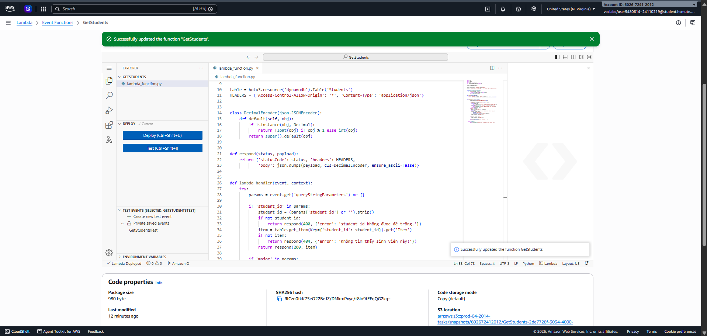
    <figcaption style="font-style: italic; color: gray;">
      Hình 1. Cập nhật hàm Lambda GetStudents.
    </figcaption>
  </figure>

  <figure>
    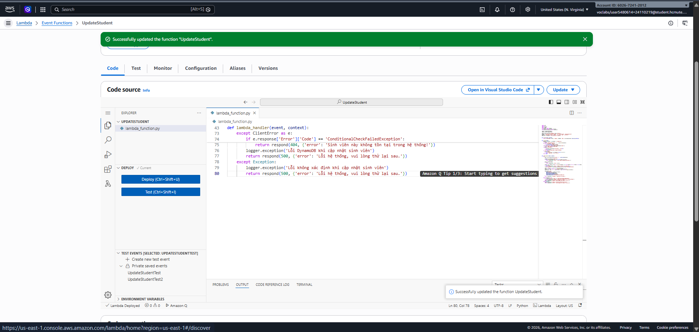
    <figcaption style="font-style: italic; color: gray;">
      Hình 2. Cập nhật hàm Lambda UpdateStudent.
    </figcaption>
  </figure>

  <figure>
    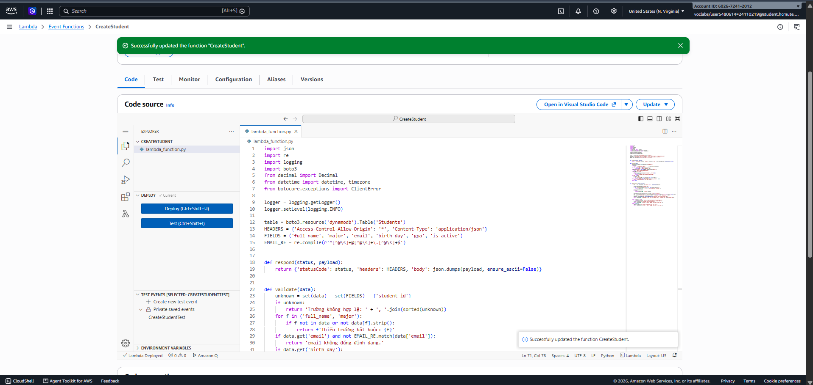
    <figcaption style="font-style: italic; color: gray;">
      Hình 3. Cập nhật hàm Lambda CreateStudent.
    </figcaption>
  </figure>

  <figure>
    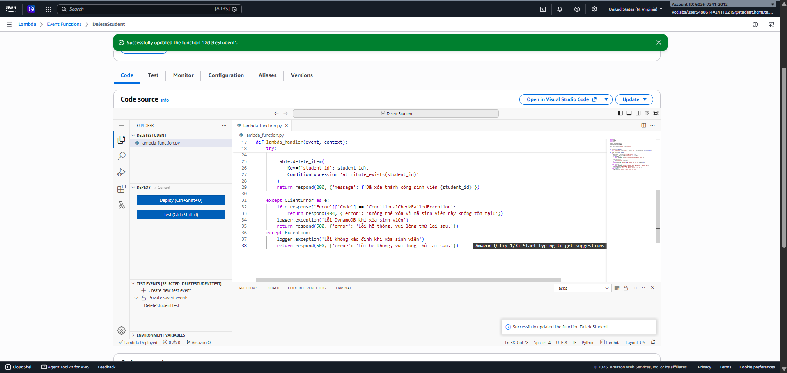
    <figcaption style="font-style: italic; color: gray;">
      Hình 4. Cập nhật hàm Lambda DeleteStudent.
    </figcaption>
  </figure>

  <figure>
    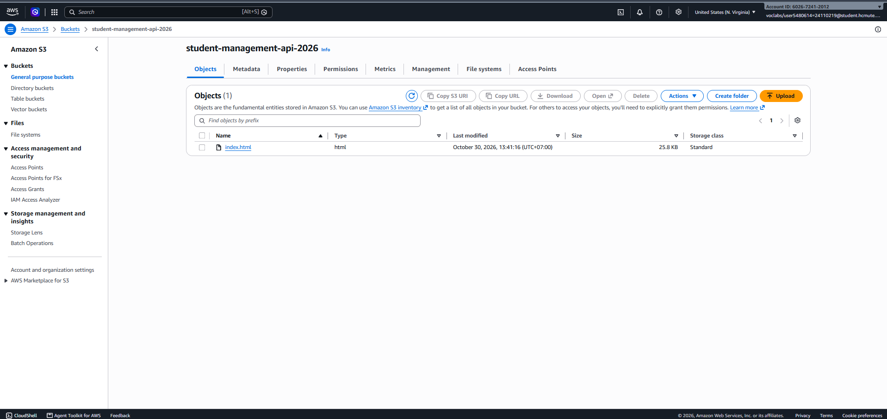
    <figcaption style="font-style: italic; color: gray;">
      Hình 5. Cập nhật giao diện và kiểm tra dữ liệu trên Frontend.
    </figcaption>
  </figure>

## 2.2. Xuất tài liệu API và kiểm thử bằng Postman

Tài liệu OpenAPI được xuất từ API Gateway để mô tả các endpoint và phương thức API của hệ thống. Postman được sử dụng để kiểm thử độc lập các thao tác tạo, đọc, cập nhật và xóa, bao gồm cả trường hợp dữ liệu không hợp lệ hoặc mã sinh viên không tồn tại.

Kết quả kiểm thử ghi nhận các phản hồi phù hợp: tạo thành công trả về HTTP `201`; dữ liệu không hợp lệ trả về HTTP `400`; mã sinh viên đã tồn tại trả về HTTP `409`; không tìm thấy hồ sơ trả về HTTP `404`; các thao tác đọc, cập nhật và xóa thành công trả về HTTP `200`.

  <figure>
    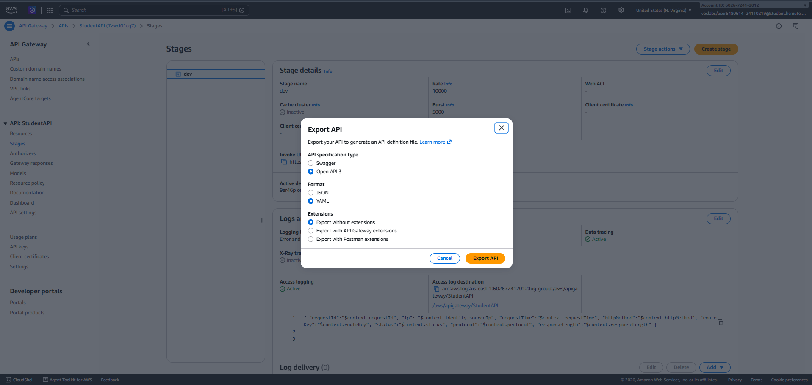
    <figcaption style="font-style: italic; color: gray;">
      Hình 6. Xuất tài liệu OpenAPI từ API Gateway.
    </figcaption>
  </figure>

  <figure>
    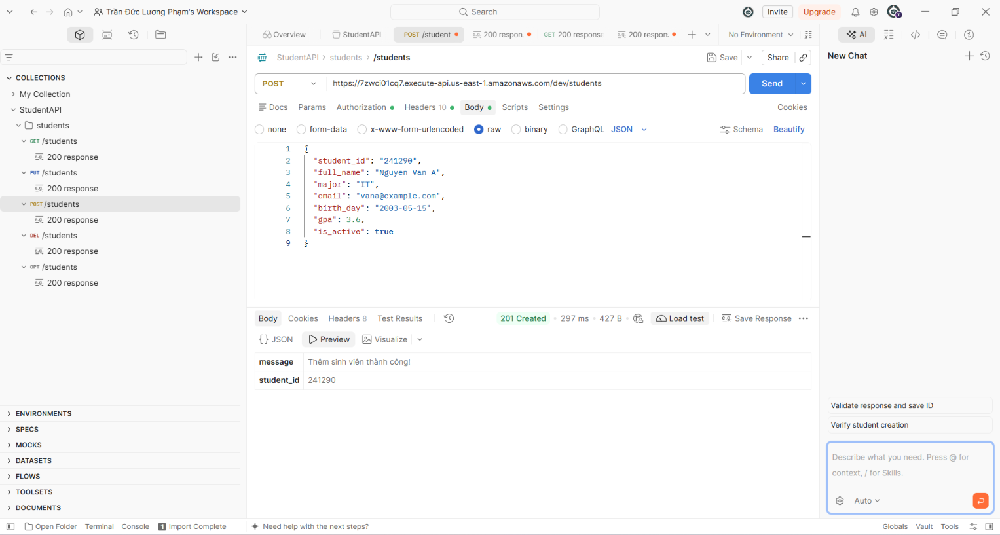
    <figcaption style="font-style: italic; color: gray;">
      Hình 7. Kiểm thử tạo sinh viên thành công bằng Postman.
    </figcaption>
  </figure>

  <figure>
    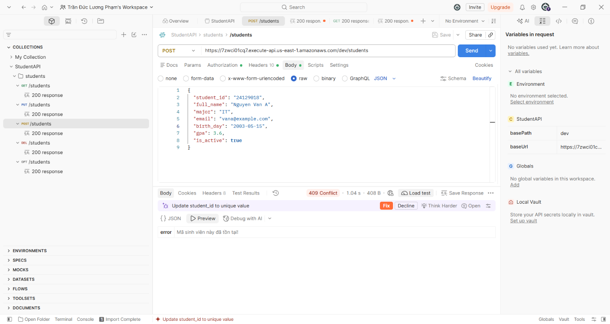
    <figcaption style="font-style: italic; color: gray;">
      Hình 8. Kiểm thử trường hợp mã sinh viên đã tồn tại.
    </figcaption>
  </figure>

  <figure>
    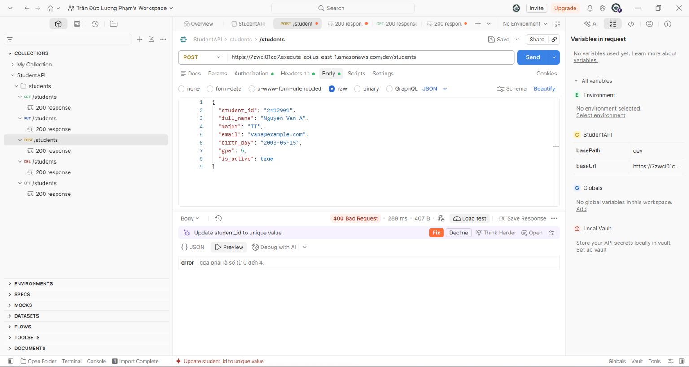
    <figcaption style="font-style: italic; color: gray;">
      Hình 9. Kiểm thử dữ liệu GPA ngoài phạm vi cho phép.
    </figcaption>
  </figure>

  <figure>
    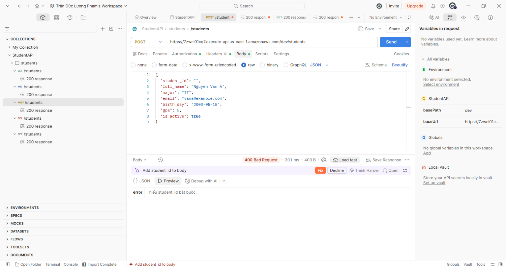
    <figcaption style="font-style: italic; color: gray;">
      Hình 10. Kiểm thử trường hợp mã sinh viên bị bỏ trống.
    </figcaption>
  </figure>

  <figure>
    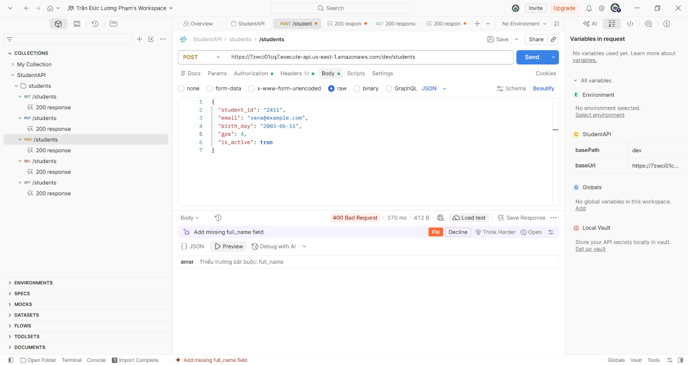
    <figcaption style="font-style: italic; color: gray;">
      Hình 11. Kiểm thử trường hợp thiếu họ tên bắt buộc.
    </figcaption>
  </figure>

  <figure>
    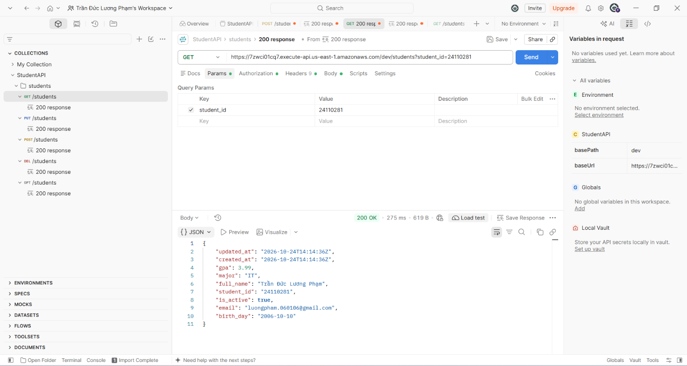
    <figcaption style="font-style: italic; color: gray;">
      Hình 12. Kiểm thử truy vấn sinh viên theo mã sinh viên.
    </figcaption>
  </figure>

  <figure>
    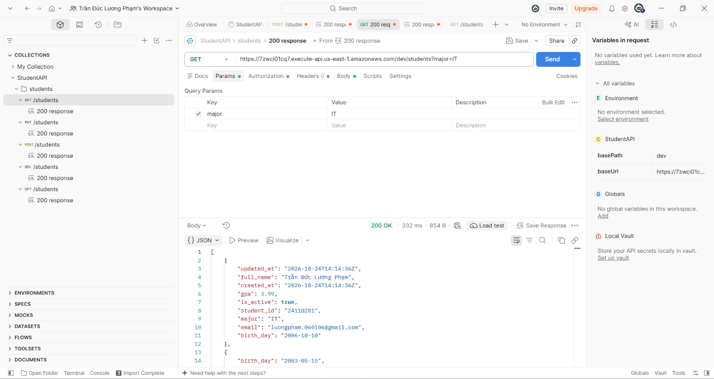
    <figcaption style="font-style: italic; color: gray;">
      Hình 13. Kiểm thử lọc sinh viên theo chuyên ngành.
    </figcaption>
  </figure>

  <figure>
    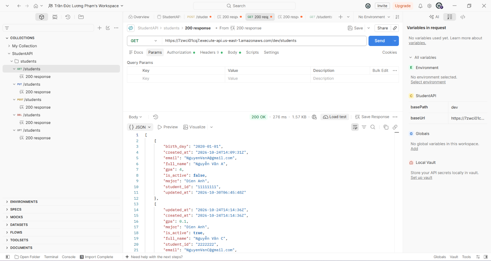
    <figcaption style="font-style: italic; color: gray;">
      Hình 14. Kiểm thử lấy toàn bộ danh sách sinh viên.
    </figcaption>
  </figure>

  <figure>
    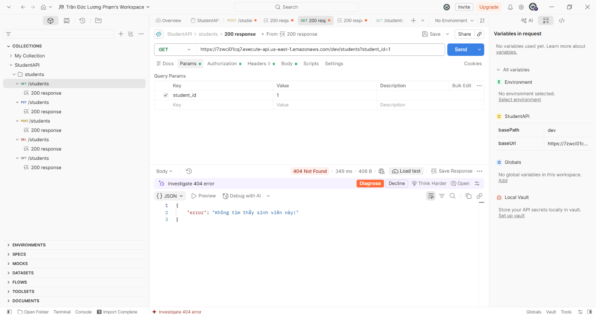
    <figcaption style="font-style: italic; color: gray;">
      Hình 15. Kiểm thử truy vấn mã sinh viên không tồn tại.
    </figcaption>
  </figure>

  <figure>
    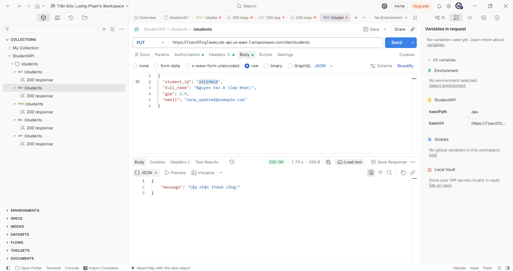
    <figcaption style="font-style: italic; color: gray;">
      Hình 16. Kiểm thử cập nhật hồ sơ thành công bằng Postman.
    </figcaption>
  </figure>

  <figure>
    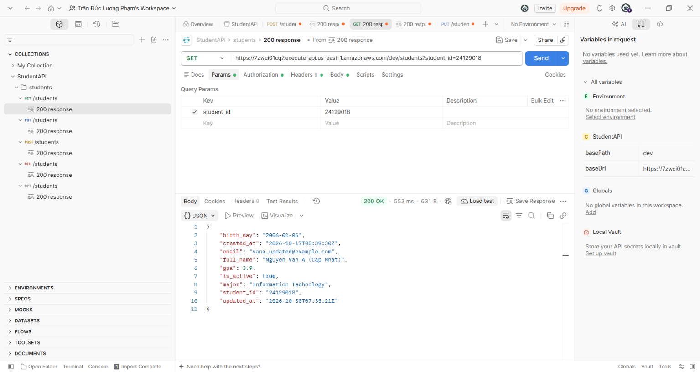
    <figcaption style="font-style: italic; color: gray;">
      Hình 17. Xác nhận dữ liệu sau cập nhật bằng yêu cầu GET.
    </figcaption>
  </figure>

  <figure>
    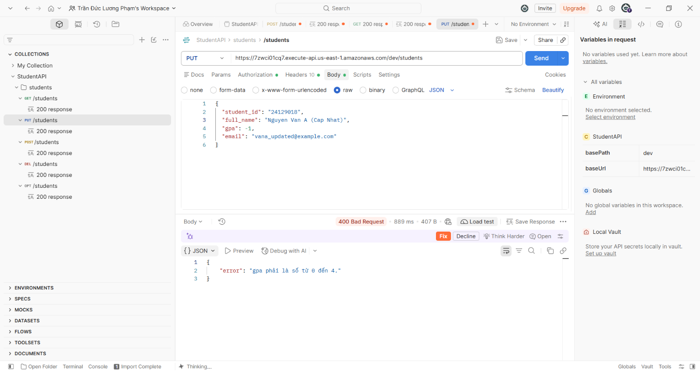
    <figcaption style="font-style: italic; color: gray;">
      Hình 18. Kiểm thử cập nhật với GPA không hợp lệ.
    </figcaption>
  </figure>

  <figure>
    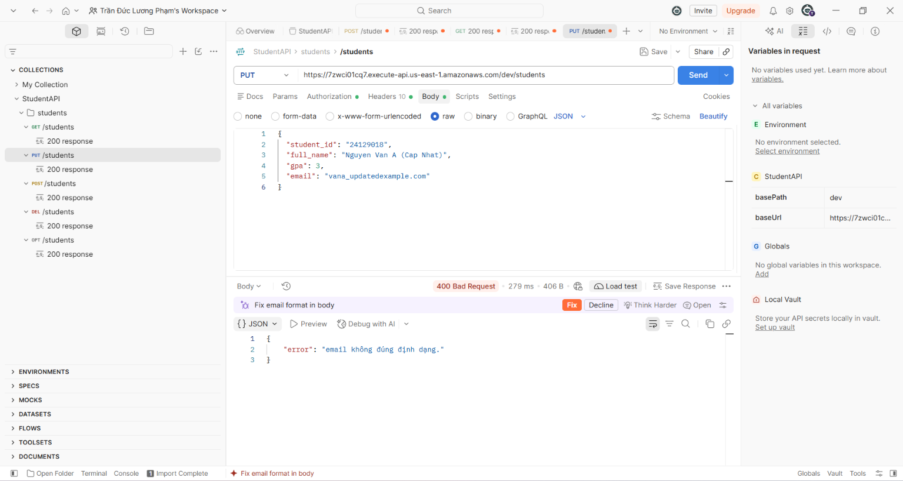
    <figcaption style="font-style: italic; color: gray;">
      Hình 19. Kiểm thử cập nhật với email không hợp lệ.
    </figcaption>
  </figure>

  <figure>
    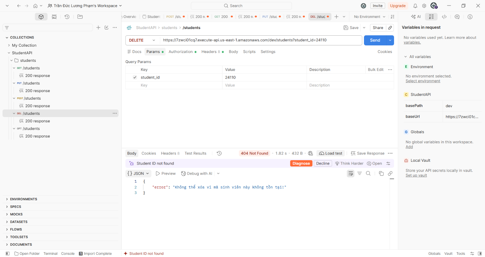
    <figcaption style="font-style: italic; color: gray;">
      Hình 20. Kiểm thử xóa mã sinh viên không tồn tại.
    </figcaption>
  </figure>

  <figure>
    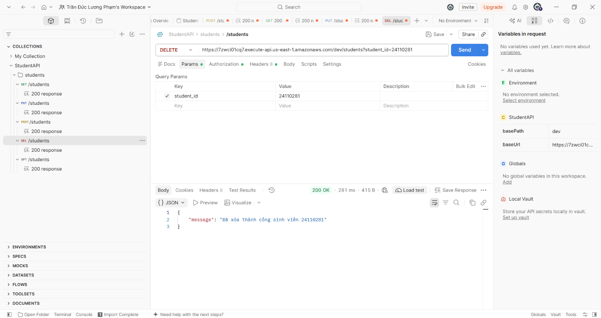
    <figcaption style="font-style: italic; color: gray;">
      Hình 21. Kiểm thử xóa sinh viên thành công.
    </figcaption>
  </figure>

## 2.3. Kiểm thử End-to-End trên giao diện website

Kiểm thử lại giao diện website được lưu trữ trên S3, bao gồm thao tác thêm, sửa, tìm kiếm và xóa sinh viên. Các tình huống dữ liệu trùng, email không hợp lệ và GPA ngoài phạm vi cũng được kiểm tra trực tiếp trên giao diện. Kết quả cho thấy giao diện hiển thị thông báo lỗi phù hợp và cho phép tiếp tục thao tác khi dữ liệu hợp lệ.

  <figure>
    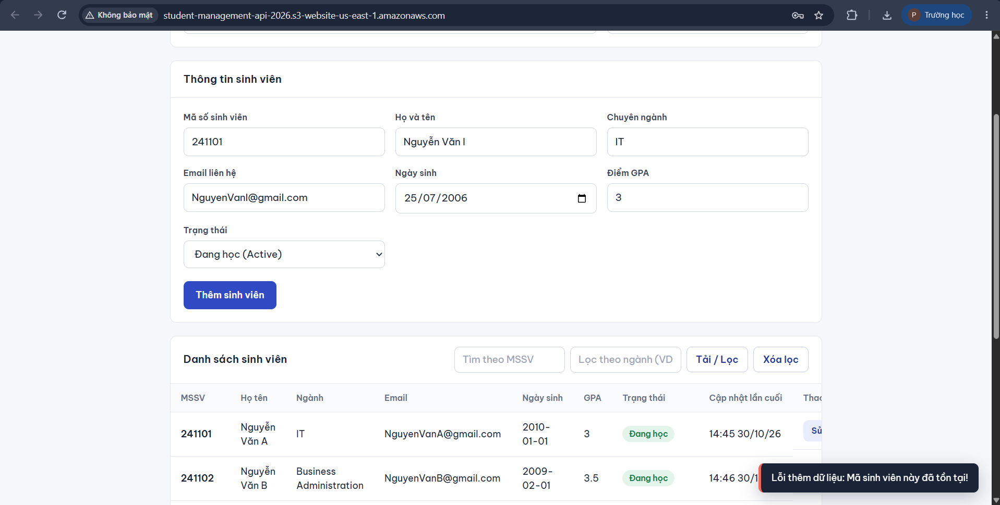
    <figcaption style="font-style: italic; color: gray;">
      Hình 22. Kiểm thử giao diện với mã sinh viên đã tồn tại.
    </figcaption>
  </figure>

  <figure>
    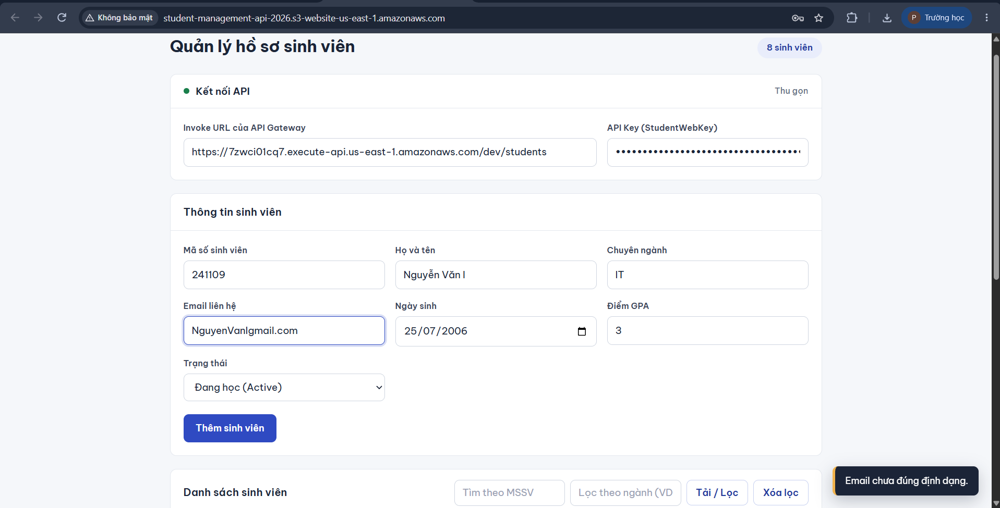
    <figcaption style="font-style: italic; color: gray;">
      Hình 23. Kiểm thử giao diện với email không hợp lệ.
    </figcaption>
  </figure>

  <figure>
    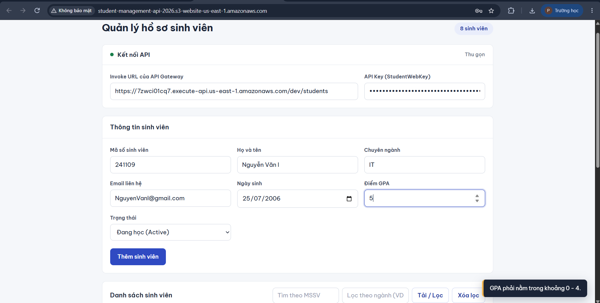
    <figcaption style="font-style: italic; color: gray;">
      Hình 24. Kiểm thử giao diện với GPA ngoài phạm vi cho phép.
    </figcaption>
  </figure>

  <figure>
    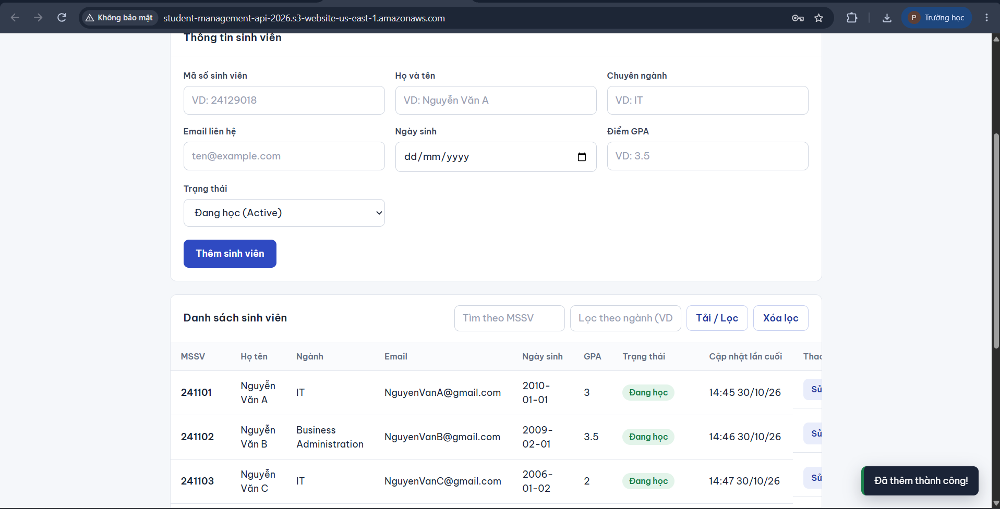
    <figcaption style="font-style: italic; color: gray;">
      Hình 25. Kiểm thử luồng E2E tạo sinh viên thành công.
    </figcaption>
  </figure>

  <figure>
    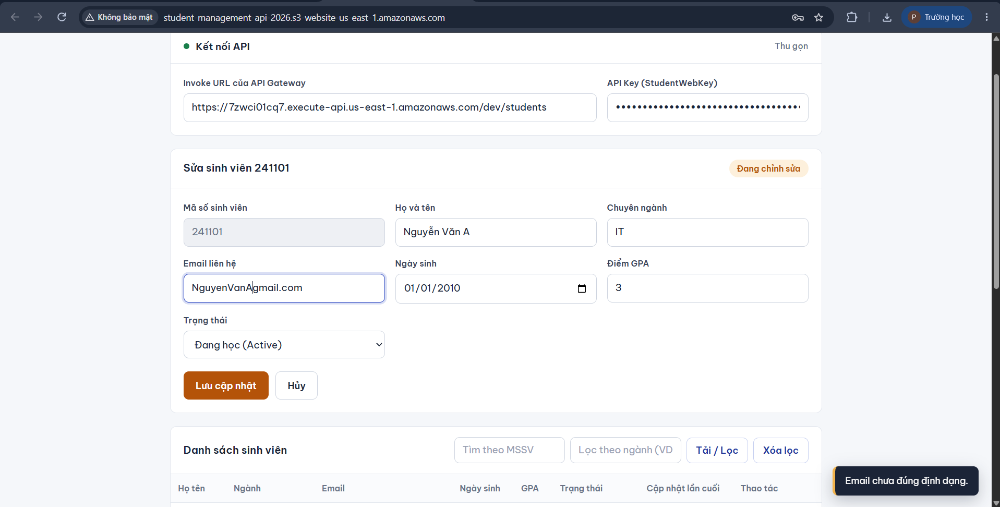
    <figcaption style="font-style: italic; color: gray;">
      Hình 26. Kiểm thử cập nhật với email không hợp lệ trên giao diện.
    </figcaption>
  </figure>

  <figure>
    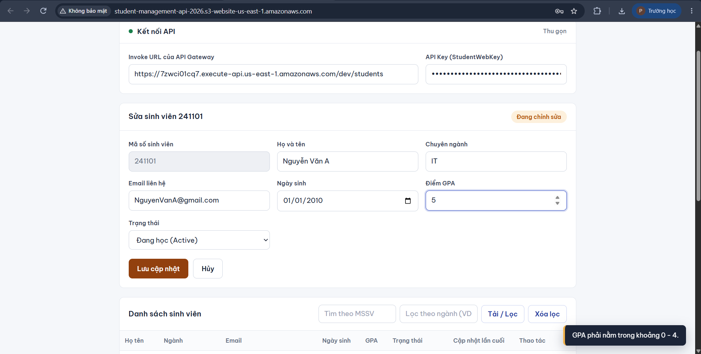
    <figcaption style="font-style: italic; color: gray;">
      Hình 27. Kiểm thử cập nhật với GPA không hợp lệ trên giao diện.
    </figcaption>
  </figure>

  <figure>
    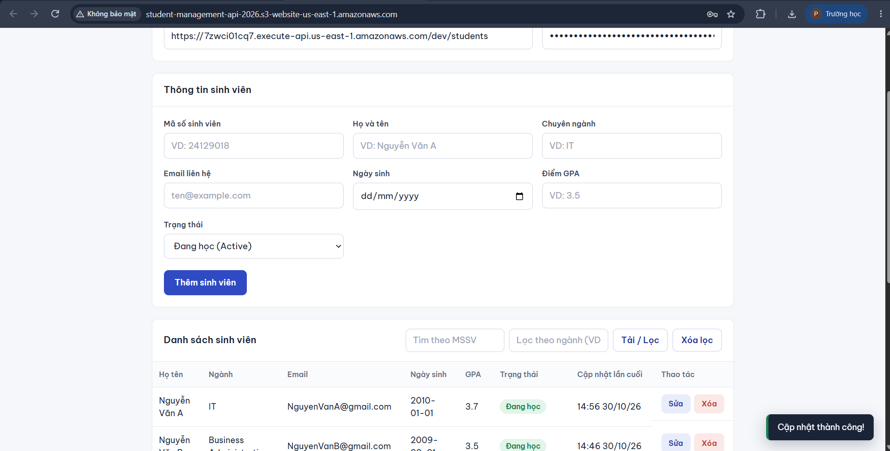
    <figcaption style="font-style: italic; color: gray;">
      Hình 28. Kiểm thử luồng E2E cập nhật sinh viên thành công.
    </figcaption>
  </figure>

  <figure>
    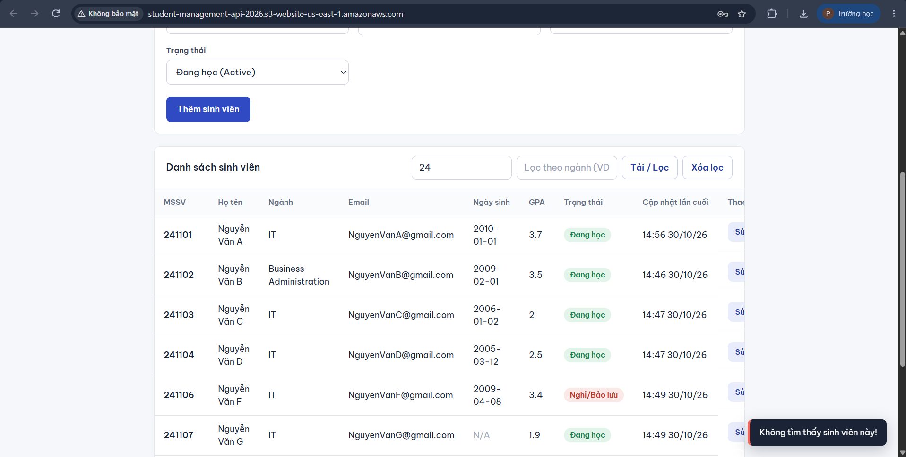
    <figcaption style="font-style: italic; color: gray;">
      Hình 29. Kiểm thử tìm kiếm mã sinh viên không có trong hệ thống.
    </figcaption>
  </figure>

  <figure>
    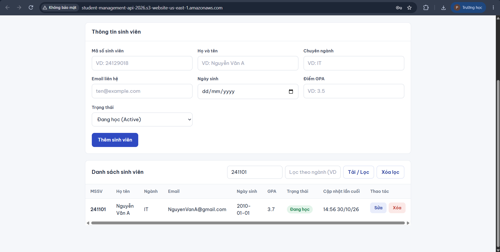
    <figcaption style="font-style: italic; color: gray;">
      Hình 30. Kiểm thử lọc danh sách theo mã sinh viên.
    </figcaption>
  </figure>

  <figure>
    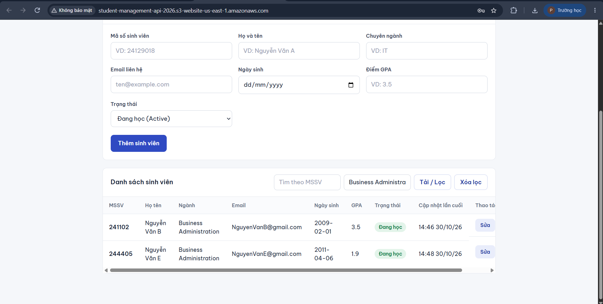
    <figcaption style="font-style: italic; color: gray;">
      Hình 31. Kiểm thử lọc danh sách theo chuyên ngành qua GSI.
    </figcaption>
  </figure>

  <figure>
    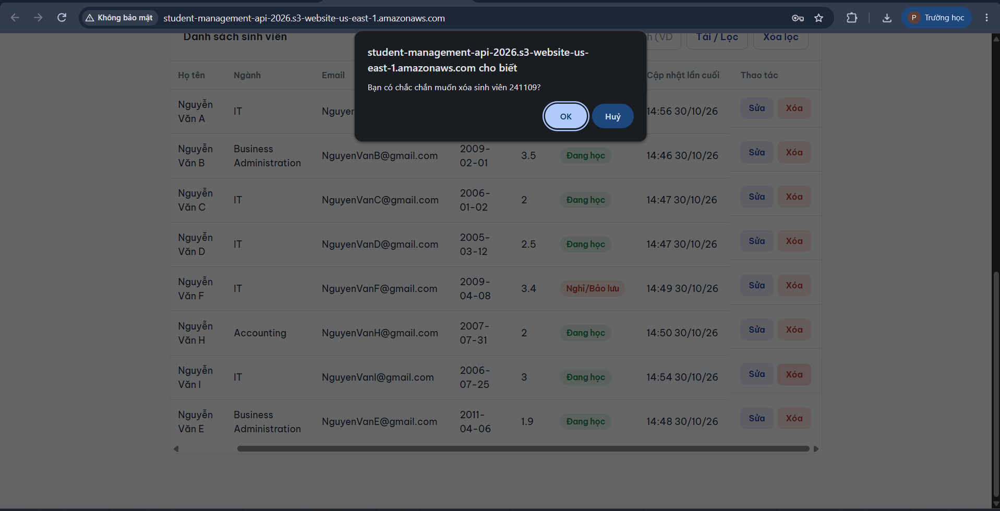
    <figcaption style="font-style: italic; color: gray;">
      Hình 32. Hộp thoại xác nhận trước khi xóa sinh viên trên giao diện.
    </figcaption>
  </figure>

## 2.4. Theo dõi tài nguyên, chi phí và dọn dẹp

Biểu đồ metrics trên CloudWatch và thông tin mức sử dụng trong AWS Billing/Cost Management được kiểm tra. Sau khi hoàn tất kiểm thử, tài nguyên DynamoDB không còn cần thiết được dọn dẹp; minh chứng ghi nhận tài nguyên DynamoDB đã được xóa.

  <figure>
    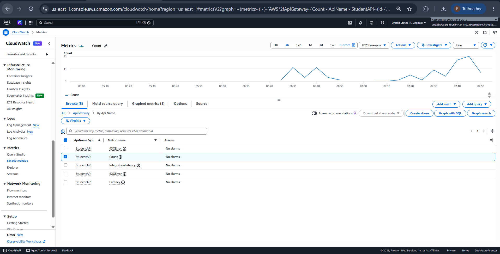
    <figcaption style="font-style: italic; color: gray;">
      Hình 33. Theo dõi biểu đồ metrics của hệ thống trên CloudWatch.
    </figcaption>
  </figure>

  <figure>
    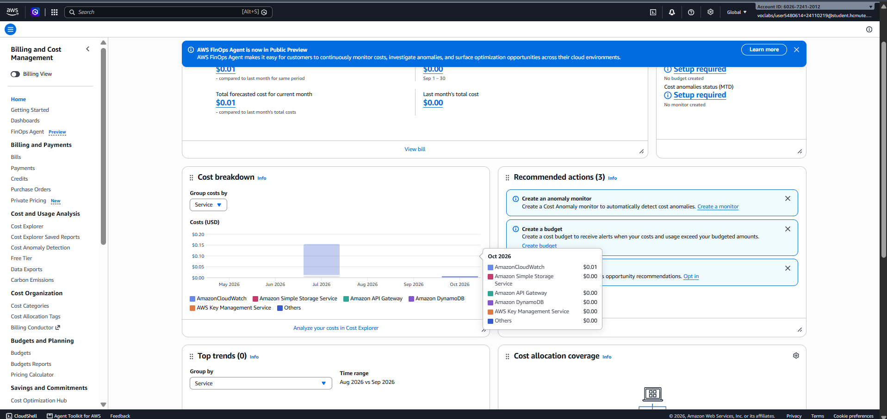
    <figcaption style="font-style: italic; color: gray;">
      Hình 34. Rà soát thông tin trong AWS Billing and Cost Management.
    </figcaption>
  </figure>

  <figure>
    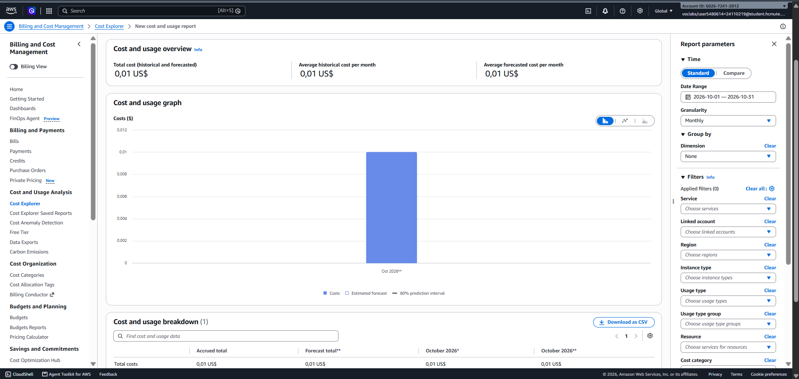
    <figcaption style="font-style: italic; color: gray;">
      Hình 35. Kiểm tra biểu đồ chi phí và mức sử dụng tài nguyên.
    </figcaption>
  </figure>

  <figure>
    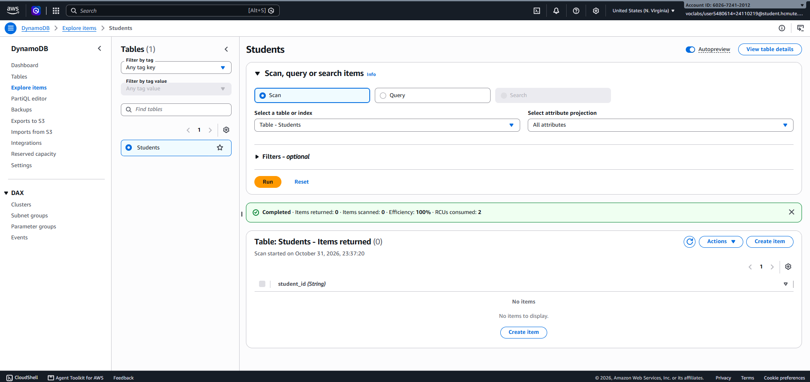
    <figcaption style="font-style: italic; color: gray;">
      Hình 36. Minh chứng dọn dẹp tài nguyên DynamoDB sau khi kiểm thử.
    </figcaption>
  </figure>

# 3. Kết quả công việc tuần 4

- Cập nhật các hàm Lambda để kiểm tra dữ liệu cho các thao tác CRUD; xử lý các trường hợp thiếu dữ liệu, dữ liệu sai định dạng, mã sinh viên trùng hoặc không tồn tại.
- Xuất tài liệu OpenAPI và kiểm thử các chức năng API bằng Postman, bao gồm cả trường hợp thành công và lỗi.
- Kiểm thử End-to-End trên giao diện S3 với các thao tác thêm, sửa, tìm kiếm, lọc và xóa sinh viên.
- Kiểm tra metrics trên CloudWatch, rà soát thông tin chi phí và lưu đầy đủ minh chứng Tuần 4.
- Dọn dẹp tài nguyên DynamoDB không còn cần thiết sau khi hoàn tất kiểm thử.
